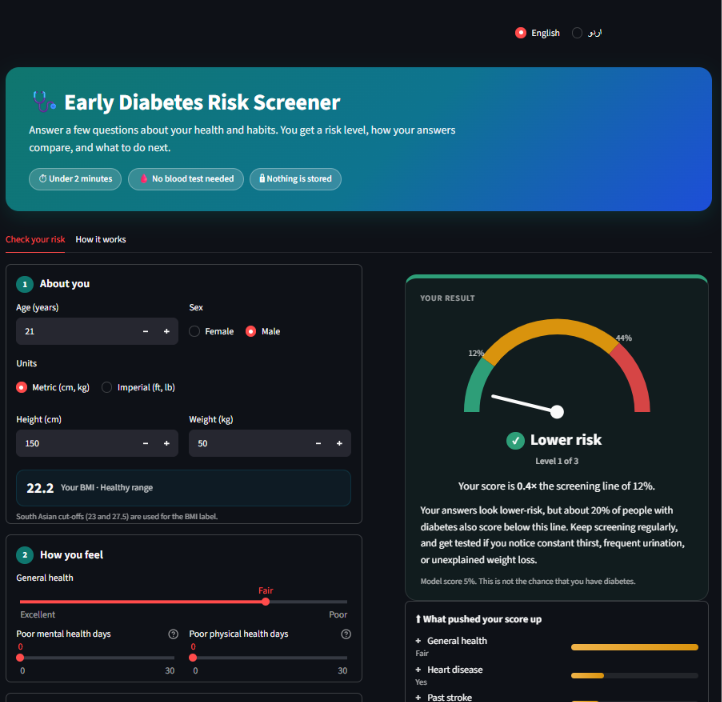
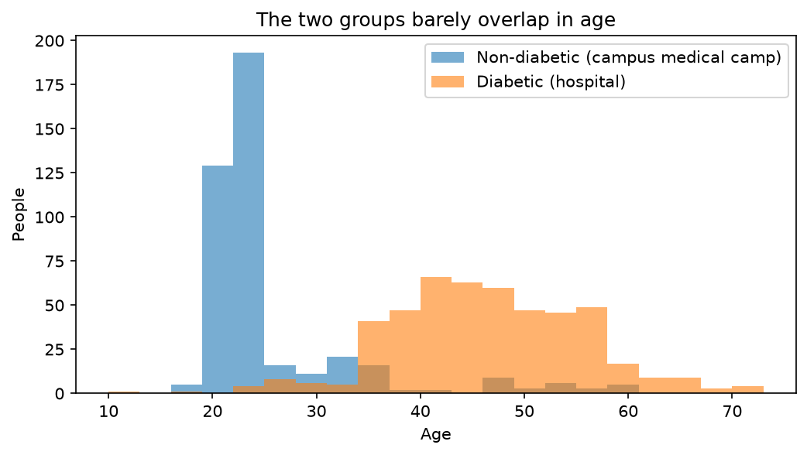
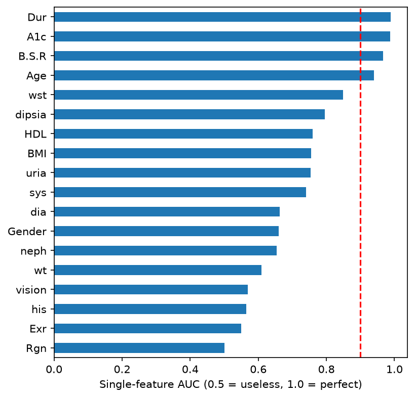
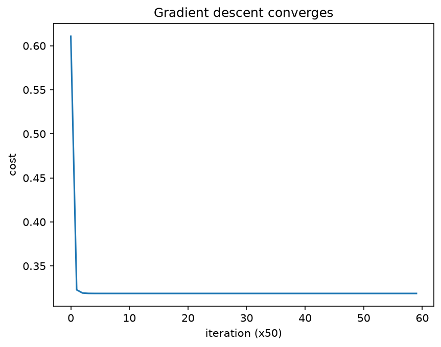
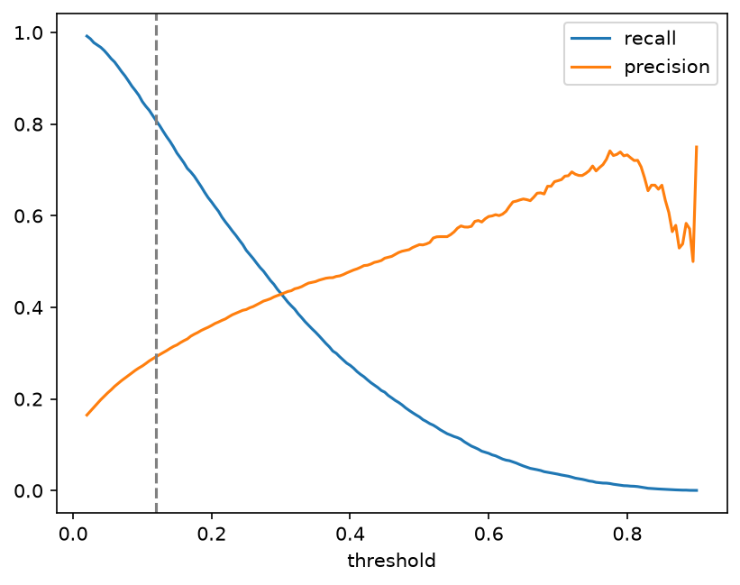
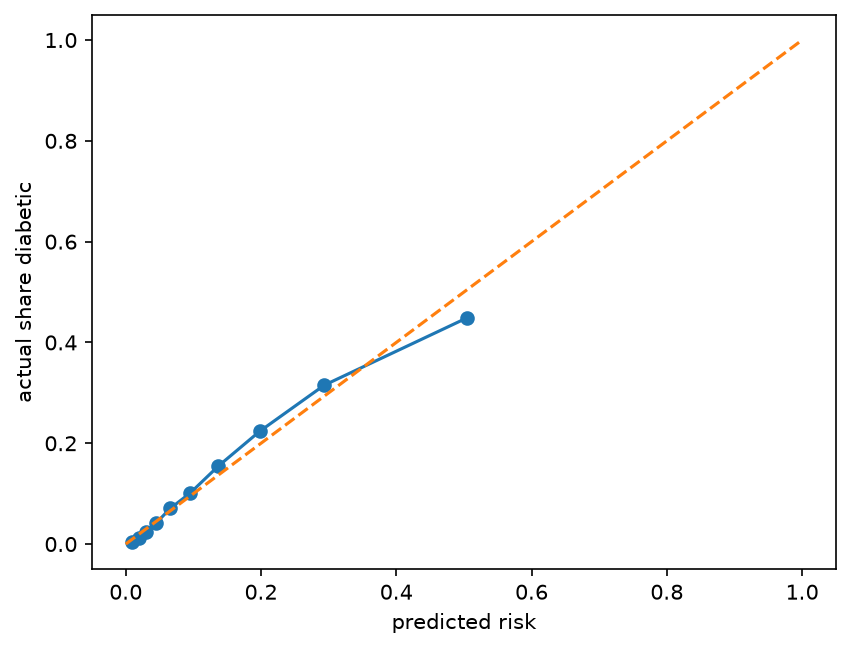

# Early Diabetes Risk Screener

An educational diabetes risk screening tool built with logistic regression
(implemented from scratch in NumPy), together with an audit of a Pakistani
diabetes dataset.

**Live demo:** https://diabetes-risk-screener-324.streamlit.app/

> This is a screening aid, not a medical diagnosis. Always confirm with a
> blood test and a doctor.



## Why this project

Pakistan has the highest age-standardised diabetes prevalence in the world:
31.4% of adults (IDF Diabetes Atlas 2025). About 34.5 million adults live
with diabetes, and roughly 27% of them are undiagnosed. Cheap, early
screening could help find people who do not know they are sick.

The project has two parts:

1. **Part 1:** I tried to train a screener on Pakistani patient data and
   audited whether that data could support it.
2. **Part 2:** I built and deployed a screener on a large dataset, with an
   honest account of its limits.

---

## Part 1: Auditing a Pakistani diabetes dataset

**Data:** "Pakistani Diabetes Dataset" (Kaggle) by Dr. Muhammad Shoaib and
Aysha Qamar. Diabetic patients (486 records) were collected at District
Headquarter Teaching Hospital (DHQTH), Sahiwal. Non-diabetic participants
(426 records) were collected at a medical camp at COMSATS University,
Sahiwal Campus. 18 predictors plus an `Outcome` label.

**Cleaning:** removed 3 rows with impossible BMI values and 2 duplicate
rows, leaving 907 records (486 diabetic, 421 non-diabetic).

### What I found

**1. The two groups come from different places and different age ranges.**
Non-diabetic participants averaged about 25 years old and diabetic patients
about 46. Age alone separates the groups with an AUC of 0.94.



**2. Several columns give away the diagnosis.** HbA1c, random blood sugar,
and duration of diabetes (zero for every non-diabetic participant) each
have a single-feature AUC above 0.96. Nephropathy is a complication of
diabetes, and thirst and frequent urination are symptoms of existing
diabetes. None of these can be used for *early* screening.



**3. A naive model looks perfect, and that result means nothing.**

All numbers are 5-fold cross-validation repeated 5 times, using logistic
regression with standardised features.

| Experiment | n | AUC (± std) | Accuracy |
|---|---|---|---|
| 1. Naive: all 18 features | 907 | 0.998 ± 0.002 | 0.989 |
| 2. Diagnostic/symptom/complication columns removed (11 features) | 907 | 0.966 ± 0.009 | 0.921 |
| 3. Age alone | 907 | 0.940 ± 0.011 | 0.919 |
| 4. Those columns removed, and Age removed (10 features) | 907 | 0.928 ± 0.014 | 0.863 |
| 5a. Ages 30-59 only: Age alone | 499 | 0.690 ± 0.107 | 0.856 |
| 5b. Ages 30-59 only: 11 features, with Age | 499 | 0.851 ± 0.039 | 0.880 |
| 5c. Ages 30-59 only: 10 features, no Age | 499 | 0.849 ± 0.048 | 0.878 |

The columns removed in experiments 2-5 are HbA1c, random blood sugar,
duration of diabetes, nephropathy, thirst, urination, and vision problems.

### How to read this

- **Experiment 1** is what a typical notebook would report: 98.9% accuracy.
  But the model is mostly reading the diagnosis.
- **Experiments 2-4** show that even with those columns removed, the model
  still performs well, because other features (waist, BMI, blood pressure)
  are strongly tied to age and to being a hospital patient.
- **Experiments 5a-5c** restrict the analysis to ages 30-59, where both
  groups exist (427 diabetic, only 72 non-diabetic). Accuracy is misleading
  here: always predicting "diabetic" would score 427 / 499 = 85.6%. AUC is
  the better measure. The non-age features carry some signal beyond age
  (AUC 0.85 vs. 0.69 for age alone), but with only 72 non-diabetic people
  the uncertainty is large, and the groups were still recruited at different
  sites, so I cannot tell whether that signal reflects diabetes or sampling.

### Conclusion

The dataset is useful for describing Pakistani diabetic patients, but not
for training a screening tool that people should rely on: its labels are
confounded with where participants were recruited, it contains leakage
columns, and the age-matched subset has too few non-diabetic participants
for reliable estimates. I therefore did not build the app on it. A Pakistani
dataset that recruits both groups from the same population would be needed.

---

## Part 2: The screener

**Data:** CDC Behavioral Risk Factor Surveillance System (BRFSS) 2015,
"Diabetes Health Indicators Dataset" on Kaggle (by Alex Teboul):
253,680 US survey responses, 13.9% diabetic. The features are things a
person can answer without a lab test.

**Features used (15):** high blood pressure, high cholesterol, BMI, smoking,
stroke, heart disease, physical activity, fruit intake, vegetable intake,
general health, mental health days, physical health days, difficulty
walking, sex, age group. I left out income, education, and
healthcare-access columns because they are specific to the US system. I
also removed heavy alcohol use after finding that the model gave it a
negative weight, which would have made the app reward drinking (see
"Findings").

### Method

- Logistic regression with L2 regularization, implemented from scratch in
  NumPy (gradient descent).
- 60% train (152,208 rows), 20% validation, 20% test (50,736 rows each),
  stratified. Scaling statistics come from the training set only. The test
  set was used once, at the end.
- **Validated against scikit-learn:** the maximum difference in learned
  weights was 0.0004, and validation AUC was 0.8178 for both
  implementations.
- Decision threshold chosen on validation data to catch about 80% of
  diabetics, because for screening a missed case is worse than a false
  alarm. Risk bands: **elevated** at score >= 0.12, **high** at >= 0.44.



### Results (held-out test set)

| Metric | Value |
|---|---|
| ROC-AUC | 0.816 |
| Recall (diabetics caught) at screening threshold | 0.80 |
| Precision at screening threshold | 0.29 |
| Specificity (healthy people correctly cleared) | 0.68 |
| Accuracy of the model at this threshold | 0.70 |
| Accuracy of "always predict healthy" | 0.861 |

Confusion matrix at the threshold (rows = actual, columns = predicted):

| | Predicted healthy | Predicted at risk |
|---|---|---|
| **Actually healthy** | 29,749 | 13,918 |
| **Actually diabetic** | 1,382 | 5,687 |

**Why accuracy is not the headline metric:** a model that always says
"healthy" scores 86.1% accuracy and finds nobody. This model has a lower
accuracy (70%) *on purpose*, because it is tuned to catch 80% of diabetic
cases. The cost is false alarms: roughly 2.4 healthy people are flagged for
every diabetic person found. For a screening test whose follow-up is a
simple blood test, that trade-off is reasonable, but it is a trade-off.



### Findings

**Regularization.** On the full training set, validation AUC was flat for
lambda from 0 to 1,000 (0.8178), and only dropped when lambda was very
large (0.8155 at 10,000 and 0.8064 at 100,000, which is underfitting). So
with 150,000 rows and 15 features there is no overfitting to fix. On small
subsamples regularization mattered:

| Training rows | lambda = 0 (train / val AUC) | lambda = 30 (train / val AUC) |
|---|---|---|
| 100 | 0.923 / 0.738 | 0.873 / 0.793 |
| 300 | 0.825 / 0.781 | 0.832 / 0.789 |
| 1,000 | 0.825 / 0.810 | 0.826 / 0.811 |
| 10,000 | 0.818 / 0.817 | 0.818 / 0.817 |
| 152,208 | 0.821 / 0.818 | 0.821 / 0.818 |

With 100 rows, the unregularized model overfits (train 0.92 vs. validation
0.74), and regularization narrows the gap and raises validation AUC by about
0.055. With enough data the gap disappears and regularization makes no
difference. This is the bias-variance behaviour from the course, observed
directly.

**Feature engineering.** Adding squared terms and interactions (BMI^2,
Age^2, BMI x Age, GenHlth x Age, BMI x GenHlth) raised validation AUC from
0.8178 to 0.8210, a gain of 0.003. I judged that too small to justify the
added complexity and kept the simple model in the app.

**What drives the score.** Odds ratio for a one-standard-deviation increase
in each feature:

| Feature | Odds ratio |
|---|---|
| General health (worse) | 1.82 |
| BMI | 1.59 |
| Age group | 1.53 |
| High blood pressure | 1.45 |
| High cholesterol | 1.34 |
| Sex (male) | 1.10 |

Heart disease (1.07), difficulty walking (1.06), and stroke (1.04) add a
little. Smoking, vegetables, fruit, and physical activity are all close to
1, so they barely move the score once health status, BMI, and age are
accounted for. Poor physical health days (0.94) and poor mental health days
(0.97) come out slightly *below* 1, even though people with more of those
days are more likely to be diabetic on their own. They are strongly
correlated with general health and difficulty walking, which already carry
that information, so their separate weights are small and not reliable to
interpret. These are associations learned from survey data, not causal
effects.

**A bug I caught.** My first version included heavy alcohol use, which got
an odds ratio of 0.83: heavy drinking *lowered* the predicted risk. A likely
reason is that people diagnosed with diabetes are advised to cut back on
drinking, so they report less of it. In the live app, a profile with
stroke, heart disease, high blood pressure, high cholesterol, smoking, and
no exercise scored only 14% when "heavy drinker" was ticked. I removed the
feature and retrained: test AUC moved from 0.817 to 0.816.

**Calibration.** Predicted scores track the observed share of diabetics
closely up to about 0.3, and are slightly higher than observed in the top
bin. The scores are calibrated to the US survey's 14% prevalence.



**Error analysis: who does the model miss?** Of the 7,069 diabetic people in
the test set, 1,382 fell below the threshold. Compared with all diabetics,
the missed group:

| | Missed | All diabetics |
|---|---|---|
| High blood pressure | 30% | 75% |
| High cholesterol | 34% | 67% |
| Average BMI | 27.7 | 31.8 |
| Heart disease or attack | 5% | 22% |
| Difficulty walking | 9% | 37% |
| Physically active | 80% | 63% |
| Poor physical health days (of 30) | 3.0 | 7.8 |

The model misses diabetics who look healthy on survey answers: lower BMI,
normal blood pressure and cholesterol, active, and slightly younger. A
questionnaire cannot detect them, and only a blood test can. This is the
main reason the app tells users with a low score to keep screening regularly
instead of treating the result as an all-clear.

---

## Limitations

- Trained on US survey data. **Not validated on Pakistani populations.**
  Risk factors and body-composition thresholds differ between populations.
- The output is a relative risk level, not the true probability of diabetes
  for any individual.
- Answers are self-reported, with no lab values.
- The model cannot tell type 1 from type 2 diabetes.
- About 2.4 false alarms per correctly flagged diabetic, by design.
- Roughly 1 in 5 diabetic people scores below the threshold and is missed.
- The "high" band (score >= 0.44) is reached rarely: a profile with stroke,
  heart disease, high blood pressure, high cholesterol, smoking, and no
  exercise scored 21% (elevated, not high). Most users will see "lower" or
  "elevated".
- Not clinically validated and not approved for medical use.

## Repository structure

```
app.py               Streamlit app
src/model.py         Logistic regression from scratch (NumPy)
models/              Saved weights, scaling values, and metadata
notebooks/
  02_audit.ipynb     Part 1: Pakistani dataset audit
  03_screener.ipynb  Part 2: model training and evaluation
reports/             Saved plots and result tables
requirements.txt
```

## Run locally

```
pip install -r requirements.txt
streamlit run app.py
```

The datasets are not included. Download them into a `data/` folder and
check each dataset's license:

- Pakistani Diabetes Dataset (Muhammad Shoaib):
  https://www.kaggle.com/datasets/mshoaibishaaq/pakistani-diabetes-dataset
- Diabetes Health Indicators Dataset (Alex Teboul):
  https://www.kaggle.com/datasets/alexteboul/diabetes-health-indicators-dataset

To reproduce the results, run the notebooks in `notebooks/` in order.

## Credits

- Pakistani Diabetes Dataset: Dr. Muhammad Shoaib, Aysha Qamar, and the
  DHQTH Sahiwal team (supervised by Dr. Sarfaraz Ahmad Khan)
- BRFSS 2015: US Centers for Disease Control and Prevention; Kaggle version
  by Alex Teboul
- Diabetes statistics: IDF Diabetes Atlas 2025
- Built after completing Course 1 of the Machine Learning Specialization

## Disclaimer

This project is for learning and demonstration. It does not provide medical
advice, diagnosis, or treatment.
